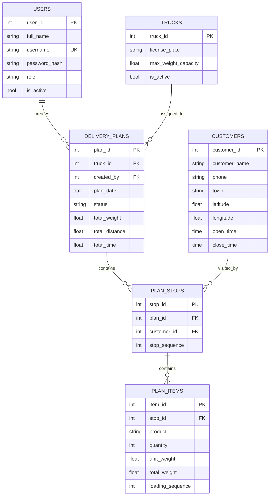
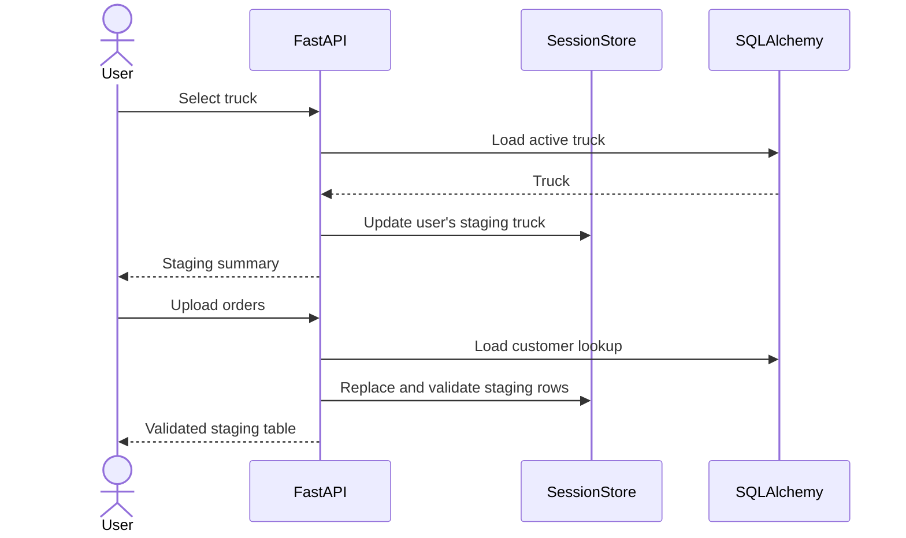
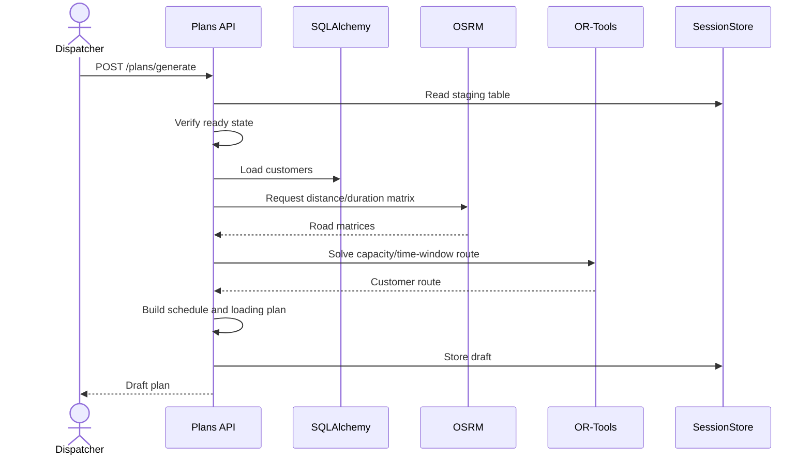

# DistriFlow System Architecture

**Status:** Sprint 3 implementation snapshot  
**Application:** Route optimization and truck-loading planning system  
**Technology base:** FastAPI, SQLAlchemy, Pydantic, OR-Tools, OSRM, SQLite/PostgreSQL

## 1. Purpose and Scope

DistriFlow prepares and evaluates delivery plans for a fleet of trucks. The system:

- authenticates Administrators and Dispatchers;
- maintains users, trucks, and customers;
- accepts order data from CSV or Excel files or through manual entry;
- validates staging rows and truck capacity;
- calculates road distance and travel-time matrices;
- generates an optimized depot-to-customer round trip;
- produces a reverse-loading sequence; and
- exposes both interactive Swagger documentation and REST APIs.

The core application is currently a modular monolith. A draft plan is held in server memory while a plan is being prepared. SQLAlchemy models for saved plans also exist, but the current API does not expose an approval or persistence workflow.

## 2. Architectural Style

DistriFlow uses a layered, single-process FastAPI monolith:

```text
Client / API consumer
        |
        v
FastAPI routers (HTTP and authorization boundary)
        |
        v
Pydantic schemas -> request/response validation
        |
        v
Domain and application services
  |- staging
  |- file parsing
  |- route optimization
  |- road-distance lookup
  |- session state
  |- password and JWT security
        |
        +----------------> SQLAlchemy models
        |                         |
        v                         v
In-memory working state     SQLite or PostgreSQL
```

This architecture separates:

- HTTP transport and routing;
- request and response models;
- database access;
- planning and validation logic;
- external road-routing integration; and
- authentication and authorization.

There is no message broker, separate worker tier, cache, or external state store in the current implementation.

## 3. Repository Layout

```text
distriflow/
|-- app/
|   |-- main.py              # FastAPI application assembly
|   |-- config.py            # Environment-backed configuration
|   |-- database.py          # SQLAlchemy engine and sessions
|   |-- dependencies.py      # Authentication and authorization dependencies
|   |-- models/              # SQLAlchemy persistence entities
|   |-- routers/             # REST endpoints
|   |-- schemas/             # Pydantic API models
|   |-- services/            # Domain logic and integrations
|   |-- static/              # Reserved static assets
|   `-- templates/           # Reserved templates
|-- tests/                   # Pytest API, model, and seed tests
|-- seed.py                  # Idempotent development seed script
|-- distriflow_dev.db        # Default SQLite database
|-- requirements.txt         # Python dependencies
|-- .env.example             # Environment-variable example
`-- README.md
```

## 4. Runtime Components

### 4.1 Application entry point

`app.main:app` creates the FastAPI application, registers all routers, and creates missing database tables during application startup.

The public health endpoint is:

```http
GET /health
```

It returns `{"status":"ok"}` and does not require authentication.

### 4.2 Database

`app/database.py` creates a SQLAlchemy engine and a `SessionLocal` session factory.

- Development defaults to a local SQLite file.
- PostgreSQL is selected by supplying `DATABASE_URL`.
- SQLite is configured with `check_same_thread=False` for threaded request handling.
- `get_db()` provides a session to each request and closes it afterward.
- `Base.metadata.create_all()` creates missing tables at startup and during seeding.

The SQLAlchemy base does not currently use migrations. Schema changes require a migration solution or, during development, recreation/reset of the database.

### 4.3 Configuration

Configuration is read from environment variables and `.env` by `app/config.py`.

Important groups are:

| Group | Examples |
|---|---|
| Database | `DATABASE_URL` |
| Security | `SECRET_KEY`, `SESSION_TIMEOUT_MINUTES`, `BCRYPT_ROUNDS` |
| Depot | `DEPOT_NAME`, `DEPOT_LATITUDE`, `DEPOT_LONGITUDE` |
| Planning | departure, service, stop, and solver limits |
| External routing | `OSRM_BASE_URL`, `OSRM_TIMEOUT_SECONDS` |
| File uploads | `MAX_UPLOAD_MB`, `MAX_UPLOAD_ROWS` |

The development secret and SQLite fallback are suitable only for local use. Production deployments must provide a strong secret and durable database.

### 4.4 HTTP routers

| Router | Responsibility |
|---|---|
| `auth` | Login, logout, and current-user lookup |
| `users` | Administrator-only account management |
| `trucks` | Truck lookup and Administrator maintenance |
| `customers` | Customer lookup and Administrator maintenance |
| `staging` | Truck selection, order upload, manual rows, and cancellation |
| `plans` | Draft-plan generation and retrieval |

FastAPI generates OpenAPI documentation and exposes it under `/docs`.

## 5. Persistence Model

The SQLAlchemy model relationships are represented below.



### Deletion behavior

- A truck or user marked inactive remains in the database because old plans may refer to it.
- Customers cannot be deleted if referenced by a saved plan stop.
- Delivery-plan stops use an orphan-delete cascade, and stops cascade to plan items.
- Users and active trucks use soft deactivation rather than hard deletion.

Only deactivation is implemented for users and trucks.

## 6. Authentication and Authorization

### Authentication

The login flow:

1. The client submits a username and password.
2. The server loads the user and verifies the bcrypt password hash.
3. A signed JWT containing `sub` (the user ID) and `exp` is issued.
4. The token is returned in the JSON response and also set in an HTTP-only cookie.
5. Protected endpoints accept either the bearer token or the cookie.

The JWT uses HS256. Passwords are never stored in plain text.

### Authorization

The dependencies in `app/dependencies.py` provide two authorization levels:

| Dependency | Allowed role |
|---|---|
| `require_dispatcher` | Any authenticated active Administrator or Dispatcher |
| `require_admin` | Administrator only |

User, customer, and truck read operations follow the role rules described in their routers. Customer and truck writes are Administrator-only. Planning and staging operations are available to both roles.

Every protected request checks that the user still exists and remains active.

## 7. Working-Session State

`SessionStore` is a process-local, thread-safe dictionary keyed by user ID.

Each `UserSession` contains:

- a `StagingTable`;
- an optional generated `DraftPlan`; and
- a last-activity timestamp.

The staging table and draft are deliberately not written to SQL tables during generation. This keeps an unfinished plan separate from approved business records.



### Session characteristics

- Entries expire after inactivity.
- State is lost when the process restarts.
- State is not shared across multiple Uvicorn worker processes.
- A mutex protects state mutations.
- Tests replace or isolate the store when needed.

For production scale-out, the store should be replaced by Redis or another shared, persistent session store.

## 8. Staging and Validation

### 8.1 Manual entry

`POST /staging/rows` creates an order line using a customer ID. The line is validated immediately.

### 8.2 File upload

Uploads support CSV and `.xlsx` files. The parser:

- normalizes common column names;
- requires Customer, Product, Quantity, and Unit weight;
- supports an optional Total weight column;
- detects CSV separators;
- decodes CSV as UTF-8 or Windows-1252;
- reads the active sheet for Excel; and
- limits file size and row count.

Blank spreadsheet rows are ignored. The first spreadsheet row is treated as the header. `row_id` values correspond to spreadsheet row numbers, allowing validation errors to name the original row.

### 8.3 Validation rules

An `OrderLine` may produce multiple independent errors:

- customer missing or unknown;
- duplicate customer-name matches;
- product missing;
- quantity missing, negative, zero, or fractional;
- unit weight missing, non-numeric, or non-positive;
- stated total weight not matching quantity multiplied by unit weight.

Invalid rows remain visible and are excluded from weight totals. Generation is blocked until every row is valid and the selected truck has enough capacity.

## 9. Route-Generation Flow



### Route steps

1. Group staged order lines by customer.
2. Reject plans with more than the configured stop limit.
3. Ask OSRM for a road distance and duration matrix.
4. Convert weight to grams and road values to integer solver units.
5. Attempt a route that honors customer opening/closing times.
6. If no time-window route exists, solve a shortest-route-only fallback.
7. Verify that every customer node was visited exactly once.
8. Walk the route to calculate arrivals, waits, and return time.
9. Reverse the delivery sequence to create the loading plan.
10. Calculate round-trip distance and metrics.

OR-Tools' routing model represents the depot as node zero and customers as numbered nodes. One vehicle, truck capacity, distance cost, and optional opening-hour dimensions are modeled. The solver applies a per-attempt time limit controlled by configuration.

### Loading sequence

The last delivery stop is loaded first, and the first delivery stop is loaded last. This is the exact reverse of the delivery route. If the truck is loaded using that sequence, the final loaded item is available at the first stop.

## 10. Draft-Plan Data Model

The optimizer creates plain dataclasses, rather than SQLAlchemy entities:

- `DraftPlan`;
- `DraftStop`;
- `DraftItem`;
- `LoadingEntry`; and
- `PlanMetrics`.

The API converts the draft to a dictionary and validates it against `DraftPlanOut` Pydantic models.

The draft stores internal routing matrices and original metrics for future reorder/reoptimization work. These fields are not emitted in the plan response.

## 11. External Integrations

### OSRM

`OsrmDistanceService` sends a `/table/v1/driving/` request to the configured OSRM server. It requests both:

- distance in metres; and
- duration in seconds.

The integration validates HTTP status, JSON structure, square matrices, and null values. OSRM failures are mapped to `DistanceServiceError`, then to HTTP 502 for plan generation.

The public OSRM service is useful for development but can be unavailable or unsuitable for production. A production deployment should use a controlled OSRM instance or approved routing provider.

### Google OR-Tools

OR-Tools performs the constrained route search. The implementation prioritizes shortest distance and applies capacity and time dimensions.

## 12. API Surface

### Authentication

| Method | Endpoint | Purpose |
|---|---|---|
| `POST` | `/auth/login` | Authenticate |
| `POST` | `/auth/logout` | Remove browser cookie |
| `GET` | `/auth/me` | Get current user |

### Users

| Method | Endpoint | Purpose |
|---|---|---|
| `GET` | `/users` | List users |
| `POST` | `/users` | Create user |
| `GET` | `/users/{id}` | Get user |
| `PUT` | `/users/{id}` | Update user |
| `DELETE` | `/users/{id}` | Deactivate user |

### Trucks

| Method | Endpoint | Purpose |
|---|---|---|
| `GET` | `/trucks` | List trucks |
| `GET` | `/trucks/{id}` | Get truck |
| `POST` | `/trucks` | Create truck |
| `PUT` | `/trucks/{id}` | Update truck |
| `DELETE` | `/trucks/{id}` | Deactivate truck |

### Customers

| Method | Endpoint | Purpose |
|---|---|---|
| `GET` | `/customers` | List customers |
| `GET` | `/customers/{id}` | Get customer |
| `POST` | `/customers` | Create customer |
| `PUT` | `/customers/{id}` | Update customer |
| `DELETE` | `/customers/{id}` | Delete unused customer |

### Staging

| Method | Endpoint | Purpose |
|---|---|---|
| `PUT` | `/staging/truck` | Select truck |
| `POST` | `/staging/upload` | Replace rows with uploaded file |
| `GET` | `/staging` | Read staging state |
| `POST` | `/staging/rows` | Add manual row |
| `PUT` | `/staging/rows/{id}` | Edit row |
| `DELETE` | `/staging/rows/{id}` | Delete row |
| `DELETE` | `/staging` | Cancel staging |

### Optimization

| Method | Endpoint | Purpose |
|---|---|---|
| `POST` | `/plans/generate` | Generate draft plan |
| `GET` | `/plans/draft` | Retrieve draft plan |

## 13. Error Handling

The application uses HTTP status codes to distinguish request, authorization, external-service, and planning failures:

- `400` for invalid staging or planning input;
- `401` for missing or invalid authentication;
- `403` for insufficient role permissions;
- `404` for missing records or state;
- `409` for duplicate or referential-integrity conflicts;
- `413` for oversized uploads;
- `502` for OSRM failures.

Planning-specific exceptions are raised in domain services and converted to HTTP responses at router boundaries.

## 14. Testing Strategy

The test suite uses pytest and FastAPI's TestClient.

Tests cover:

- authentication and role restrictions;
- customer CRUD behavior;
- truck CRUD behavior;
- user CRUD behavior;
- SQLAlchemy models and seed data; and
- database override fixtures.

The test database is in-memory SQLite and is isolated for each test session. External distance services should be injected or replaced with a fake implementation so optimization tests do not depend on internet connectivity.

Recommended test commands:

```powershell
cd distriflow
.venv\Scripts\activate
python -m pytest -v
```

## 15. Deployment

### Development

```powershell
python -m venv .venv
.venv\Scripts\activate
pip install -r requirements.txt
Copy-Item .env.example .env
python seed.py
uvicorn app.main:app --reload
```

### Production considerations

Run one or more Uvicorn/Gunicorn workers behind HTTPS termination. Production deployments should:

- set a strong random `SECRET_KEY`;
- use PostgreSQL;
- add database migrations;
- replace the public OSRM endpoint or self-host OSRM;
- use a shared session store;
- restrict CORS origins;
- enable cookie secure mode under HTTPS;
- set upload and solver limits deliberately;
- add structured logging and metrics;
- run health/readiness checks;
- pin and separately audit runtime dependencies.

Do not run multiple workers with the current `SessionStore`, because staging and draft state will not be shared between workers.

## 16. Operational Data Lifecycle

```text
Login
  -> process-local user session
  -> select truck
  -> add or upload orders
  -> validate staging
  -> generate draft
  -> hold in memory
  -> [future approval workflow]
  -> delivery_plans, plan_stops, plan_items
```

Draft plans are ephemeral. Only SQLAlchemy entities exist for approved plans; there is currently no API endpoint or service that copies a draft into those tables.

## 17. Current Implementation Gaps

The following items should be considered when presenting or operating the application:

- Saved-plan approval, CRUD, and retrieval endpoints are not implemented.
- `SessionStore` is process-local and is not suitable for multi-worker deployment.
- Logout removes the authentication cookie but does not clear the server-side `SessionStore`.
- The plan, staging, and session implementation uses in-memory state rather than database transactions.
- Database setup uses `create_all` and has no Alembic migration system.
- Several imports are not declared in `requirements.txt`, including `requests`, `ortools`, and `openpyxl`; the environment must provide them or the manifest must be completed.
- The distance integration depends on network availability.
- A public OSRM endpoint may impose latency or usage restrictions.
- The authorization dependencies refer to cookie configuration names that should be kept consistent with `app/config.py`.
- JWT inactivity is represented through the token expiry and refreshed cookie behavior, but the implementation should be reviewed as one coherent session policy.

These gaps do not prevent the documented current workflows from operating, but they define the boundary between a diploma/development implementation and a production-ready system.

## 18. Recommended Evolution

A likely production evolution is:

1. Add Alembic migrations.
2. Add approval endpoints and transactional saved-plan persistence.
3. Move staging/drafts to Redis or database-backed state.
4. Introduce an application/service layer for plan approval and reoptimization.
5. Add audit fields such as created/updated timestamps and actor IDs.
6. Add idempotency for plan generation and approval.
7. Add background execution for long-running optimization.
8. Add CORS and HTTPS/security middleware.
9. Add Prometheus/OpenTelemetry metrics.
10. Add automated integration tests against PostgreSQL and a local OSRM service.
