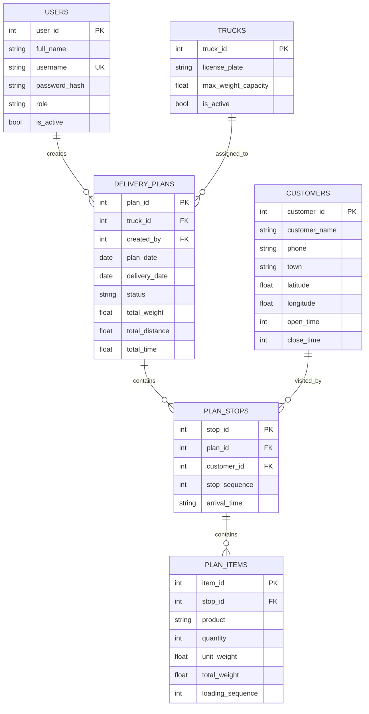
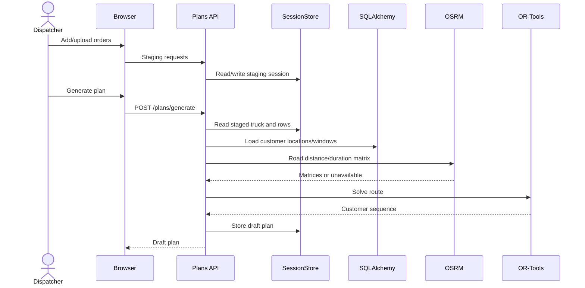

# DistriFlow System Architecture

**Status:** Current implementation snapshot

**Application:** Route optimization, truck loading, and delivery-plan management system

**Technology base:** Python, FastAPI, SQLAlchemy, Pydantic, Jinja2, Google OR-Tools, OSRM, SQLite/PostgreSQL

## 1. Purpose

DistriFlow is a modular monolith for planning and managing delivery operations. It provides:

- Administrator and Dispatcher authentication;
- user, truck, and customer administration;
- manual order entry or CSV/Excel order upload;
- staged order validation and truck capacity checks;
- road-distance and travel-time lookup;
- depot-to-customer route optimization with time windows;
- reverse-loading sequence generation;
- draft-plan review and manual stop reordering;
- transactional approval and saved-plan status management;
- dashboard metrics and a server-rendered browser interface.

The application exposes both HTML pages and JSON API endpoints. A plan moves through in-memory staging and draft states before it is approved and persisted in SQLAlchemy tables.

## 2. Architectural Style

DistriFlow is a single-process, layered FastAPI modular monolith:

```text
Browser / API consumer
        |
        v
Jinja2 HTML pages         FastAPI JSON routers
        |                         |
        +------------+------------+
                     v
          Authentication and role dependencies
                     |
                     v
             Pydantic schemas
                     |
                     v
  Staging, optimization, persistence, security services
                     |
       +-------------+-------------+
       v                           v
Process-local SessionStore   SQLAlchemy models
                                      |
                                      v
                              SQLite / PostgreSQL
                     |
                     v
              OSRM + Haversine fallback
                     |
                     v
                   OR-Tools
```

The main boundaries are HTTP/UI transport, Pydantic validation, application/domain services, SQLAlchemy persistence, and external routing.

There is no message broker, background-worker tier, cache, or shared external session store.

## 3. Runtime Assembly

`app.main:app` creates the FastAPI application, sets metadata/version `1.0.0`, registers page and API routers, enables CORS, mounts `app/static`, and creates missing database tables through SQLAlchemy `create_all()` at startup.

| Component | Location |
|---|---|
| Application assembly | `app/main.py` |
| Environment configuration | `app/config.py` |
| Database and sessions | `app/database.py` |
| Authentication dependencies | `app/dependencies.py` |
| Persistence entities | `app/models/` |
| HTTP/API and page routers | `app/routers/` |
| Request/response models | `app/schemas/` |
| Domain and integration services | `app/services/` |
| Browser templates | `app/templates/` |
| Browser assets | `app/static/` |
| Automated tests | `tests/` |

The public health endpoint is `GET /health`, which returns `{"status":"ok"}`.

## 4. Browser Interface

Jinja2 serves the application pages. JavaScript in `app/static/js/` calls the JSON endpoints and updates the rendered interface.

| Page | Route |
|---|---|
| Login | `/login` |
| Dashboard | `/dashboard` |
| Staging | `/staging` |
| New plan | `/plan/new` |
| Draft plan | `/plans/draft/view` |
| Approved plan | `/plans/approved` |
| Saved plan history | `/plans/history` |
| Customer administration | `/admin/customers` |
| Truck administration | `/admin/trucks` |
| User administration | `/admin/users` |

FastAPI also exposes interactive OpenAPI documentation at `/docs`.

## 5. Persistence Model



The database layer is SQLAlchemy 2.0. Development uses SQLite when `DATABASE_URL` is configured for a SQLite file; PostgreSQL is supported through `DATABASE_URL`.

SQLAlchemy `create_all()` creates missing tables, but no Alembic migration workflow is present. User and truck records use soft deactivation. Customers are retained or prevented from being deleted where plan references require it. Delivery plans cascade to stops and plan items through SQLAlchemy relationships.

## 6. Authentication and Authorization

### Authentication

1. `POST /auth/login` loads a user by username.
2. The submitted password is checked with bcrypt against `password_hash`.
3. A signed HS256 JWT is issued with the user ID and expiry.
4. The response includes the token and sets an HTTP-only cookie.
5. Protected endpoints read the bearer token first, then the cookie.

`POST /auth/logout` clears the server-side working session for the user and deletes the browser cookie.

### Roles

| Dependency | Allowed users |
|---|---|
| `require_dispatcher` | Any active authenticated Administrator or Dispatcher |
| `require_admin` | Administrators only |

Every protected request reloads the user and rejects inactive or missing accounts. User, customer, and truck write operations follow Administrator-only rules where implemented.

## 7. Working Session State

`SessionStore` is a process-local, thread-safe dictionary keyed by user ID.

Each `UserSession` contains:

- a `StagingTable`;
- an optional `DraftPlan`;
- a last-activity timestamp.

This state is deliberately separate from approved records. Staging and draft plans are lost on process restart and are not shared across Uvicorn worker processes.

Session entries expire after `SESSION_TIMEOUT_MINUTES` of inactivity. Logout removes the user's session. A lock protects mutations and concurrent access.

For horizontal deployment or restart-safe sessions, the implementation needs Redis, a database-backed session service, or another shared state store.

## 8. Staging and Order Validation

The staging table stores the selected truck, manual/uploaded order rows, and derived valid-row totals.

### Truck selection

`PUT /staging/truck` sets the truck ID, license plate, and capacity for the user's working session.

### Manual rows

Manual orders are created and edited through `/staging/rows`. Customer names are resolved through the database-backed customer lookup.

### File uploads

`POST /staging/upload` replaces the current staging rows. It supports CSV and `.xlsx` files.

The file reader:

- normalizes common header names;
- requires Customer, Product, Quantity, and Unit weight;
- supports an optional total-weight column;
- detects CSV separators;
- handles UTF-8 and Windows-1252 CSV text;
- reads the active Excel worksheet;
- applies upload size and row limits;
- ignores blank spreadsheet rows;
- uses the original spreadsheet row number in validation feedback.

### Validation

A row can report independent issues for missing/unknown/ambiguous customers, missing product, invalid quantity, invalid unit weight, and a stated total that does not equal quantity multiplied by unit weight.

Invalid rows remain visible and are excluded from valid totals. Generation requires:

- a selected truck;
- at least one row;
- no invalid rows;
- weight within truck capacity.

## 9. Route-Generation Flow



The optimizer:

1. groups order lines by customer;
2. enforces the configured maximum stop count;
3. constructs a matrix with depot node zero;
4. requests road distances and durations;
5. converts weight to grams and solver limits to integer units;
6. solves a one-vehicle capacity-constrained route;
7. first applies customer opening/closing time windows;
8. retries without time windows if no feasible window-respecting route exists;
9. verifies that every customer is visited exactly once;
10. calculates leg distances, arrivals, waits, and depot return time;
11. reverses the delivery route to create the loading plan;
12. returns a warning for route or window fallback cases.

OR-Tools uses distance as the arc cost and models truck capacity and optional customer time windows. Solver attempts are limited by configuration. The fallback route is still capacity-constrained and identifies all stops.

For loading, stop 1 is loaded last and the final stop is loaded first. Loading sequence is therefore the exact reverse of delivery sequence.

## 10. Draft and Saved-Plan Models

Draft plans are plain Python dataclasses:

- `DraftPlan`;
- `DraftStop`;
- `DraftItem`;
- `LoadingEntry`;
- `PlanMetrics`.

Internal matrices and original metrics are retained in the draft session for reordering, but are not exposed through `DraftPlanOut`.

The following route state exists in addition to optimization:

- `/plans/draft/stops/{stop_id}` supports manual sequence adjustment;
- `/plans/draft/reorder` accepts a complete customer-ID sequence;
- `/plans/approve` copies the draft into SQL tables;
- `/plans/list` and `/plans/{plan_id}` read saved plans;
- `/plans/{plan_id}/status` changes plan status;
- `/plans/draft` retrieves the current in-memory draft.

Approval is dispatched as one database transaction that creates the `DeliveryPlan`, associated `PlanStop` rows, and `PlanItem` rows. The draft is removed from the session after a successful commit.

Draft stop reordering recalculates the reverse loading sequence and metrics. It uses the matrices retained in the draft instead of requesting OSRM again.

## 11. Distance Integration

`OsrmDistanceService` requests OSRM `/table/v1/driving/` data for both distance and duration.

The integration is resilient rather than raising `DistanceServiceError`: HTTP failures, OSRM JSON errors, connection errors, missing coordinates, and zero coordinates trigger a straight-line Haversine fallback. The fallback estimates travel time at 40 km/h.

This behavior keeps planning available without OSRM, at the cost of replacing road distance with approximate geometry. Warnings are currently printed to server logs rather than returned as a route-generation field.

## 12. API Surface

### Authentication

| Method | Endpoint | Purpose |
|---|---|---|
| `POST` | `/auth/login` | Authenticate and create cookie/token |
| `POST` | `/auth/logout` | Clear session and cookie |
| `GET` | `/auth/me` | Return current user |

### Users

| Method | Endpoint | Purpose |
|---|---|---|
| `GET` | `/users` | List users |
| `POST` | `/users` | Create user |
| `GET` | `/users/{user_id}` | Get user |
| `PUT` | `/users/{user_id}` | Update user |
| `DELETE` | `/users/{user_id}` | Deactivate user |

### Trucks

| Method | Endpoint | Purpose |
|---|---|---|
| `GET` | `/trucks` | List trucks |
| `GET` | `/trucks/{truck_id}` | Get truck |
| `POST` | `/trucks` | Create truck |
| `PUT` | `/trucks/{truck_id}` | Update truck |
| `DELETE` | `/trucks/{truck_id}` | Deactivate truck |

### Customers

| Method | Endpoint | Purpose |
|---|---|---|
| `GET` | `/customers` | List customers |
| `GET` | `/customers/{customer_id}` | Get customer |
| `POST` | `/customers` | Create customer |
| `PUT` | `/customers/{customer_id}` | Update customer |
| `DELETE` | `/customers/{customer_id}` | Delete unused customer |

### Staging

| Method | Endpoint | Purpose |
|---|---|---|
| `PUT` | `/staging/truck` | Select truck |
| `POST` | `/staging/upload` | Replace rows from CSV/XLSX |
| `GET` | `/staging/read` | Read staging state |
| `POST` | `/staging/rows` | Add row |
| `PUT` | `/staging/rows/{row_id}` | Edit row |
| `DELETE` | `/staging/rows/{row_id}` | Delete row |
| `DELETE` | `/staging` | Clear staging |

### Plans and dashboard

| Method | Endpoint | Purpose |
|---|---|---|
| `POST` | `/plans/generate` | Generate draft |
| `GET` | `/plans/draft` | Read draft |
| `PATCH` | `/plans/draft/stops/{stop_id}` | Move a draft stop |
| `POST` | `/plans/draft/reorder` | Reorder all draft stops |
| `POST` | `/plans/approve` | Persist approved plan |
| `GET` | `/plans/list` | List saved plans |
| `GET` | `/plans/{plan_id}` | Read saved plan |
| `PATCH` | `/plans/{plan_id}/status` | Change plan status |
| `GET` | `/dashboard/stats` | Read KPIs, fleet status, and activity |

## 13. Dashboard

`GET /dashboard/stats` calculates:

- active plans for today;
- total plans and plans created today;
- active truck count;
- customer count;
- the five most recent plans;
- approved/in-progress/delivered status counts;
- a configurable daily activity chart.

All dashboard counts are read live from SQLAlchemy.

## 14. Configuration

Configuration is read through `app/config.py` from environment variables and `.env`.

| Area | Settings |
|---|---|
| Database | `DATABASE_URL` |
| Security | `SECRET_KEY`, `ALGORITHM`, `SESSION_TIMEOUT_MINUTES`, `BCRYPT_ROUNDS` |
| Depot | `DEPOT_NAME`, `DEPOT_LATITUDE`, `DEPOT_LONGITUDE` |
| Planning | `DEPARTURE_TIME_MINUTES`, `SERVICE_MINUTES_PER_STOP`, `MAX_STOPS`, `OPTIMIZER_MAX_SECONDS` |
| Routing | `OSRM_BASE_URL`, `OSRM_TIMEOUT_SECONDS` |
| Uploads | `MAX_UPLOAD_MB`, `MAX_UPLOAD_ROWS` |

The login cookie uses HTTP-only, SameSite=Lax, and the configuration-controlled secure flag.

The checked-in implementation assumes required environment values are supplied. Deployment must provide a strong `SECRET_KEY`, database URL, depot coordinates, and routing/planning settings.

## 15. Error Handling

HTTP responses separate validation, authorization, persistence, and external-routing outcomes:

- `400` for invalid staging, planning, reordering, or status input;
- `401` for missing or invalid authentication;
- `403` for insufficient role permissions;
- `404` for missing users, records, drafts, or plans;
- `409` for duplicate/conflicting maintenance operations where applied;
- `413` for oversized uploads;
- `201` for plan approval and created resources.

The routing service's Haversine fallback means unavailable OSRM does not currently map to HTTP 502; it is instead handled as a warning and approximate fallback. Planning and persistence exceptions are converted to HTTP responses at router boundaries.

## 16. Testing

The pytest suite uses FastAPI `TestClient` and in-memory or isolated SQLAlchemy database fixtures.

Current coverage focuses on:

- login and role restrictions;
- customer CRUD;
- truck CRUD;
- user CRUD;
- SQLAlchemy models and seed data.

Recommended command:

```powershell
.venv\Scripts\activate
python -m pytest -v
```

Tests that depend on optimization should replace OSRM with a deterministic distance-service implementation. Plan persistence and dashboard behavior should also be tested against an isolated database.

## 17. Deployment

Run the application with Uvicorn:

```powershell
python -m venv .venv
.venv\Scripts\activate
pip install -r requirements.txt
Copy-Item .env.example .env
python seed.py
uvicorn app.main:app --reload
```

For deployment:

- use HTTPS and a strong random secret;
- set `COOKIE_SECURE=True` when served over HTTPS;
- use PostgreSQL and add migrations;
- run a controlled/self-hosted OSRM service;
- use a shared session store before enabling multiple workers;
- restrict CORS origins;
- add structured logging and metrics;
- set deliberate upload and solver limits;
- configure health and readiness checks;
- add operational backups.

Do not run the current `SessionStore` across multiple Uvicorn workers: staging and drafts would be split across processes.

## 18. Dependencies and Known Gaps

The implementation currently imports additional runtime packages that are not all declared in `requirements.txt`:

- `requests`;
- `ortools`;
- `openpyxl`;
- Jinja2 support is normally provided transitively but can be declared explicitly.

The dependency manifest should be reconciled with the actual imports before a clean deployment.

Other current limitations:

- no database migration system;
- process-local staging and drafts;
- no real-time routing status or background optimization;
- no implemented export endpoint despite the CSV export helper;
- OSRM failure is silently logged as it falls back to Haversine;
- the dashboard and plan APIs lack dedicated integration tests;
- manual reordering recalculates metrics using retained matrices but does not call the external routing service;
- plan status is restricted to `approved`, `in_progress`, and `delivered`;
- authorization and session constants should be kept consistent by adding/fixing a dedicated inactivity setting;
- the application has one in-process security configuration and no refresh-token model.

## 19. Recommended Evolution

1. Add Alembic migrations and schema versioning.
2. Move staging and drafts into Redis or durable database state.
3. Add a transactional plan approval and status audit service.
4. Expose plan CSV/PDF export endpoints.
5. Add structured routing-fallback reporting and provider-health checks.
6. Run optimization in bounded background tasks for larger plans.
7. Add PostgreSQL, OSRM, and browser-level integration tests.
8. Add audit timestamps and actor fields.
9. Complete and pin all runtime dependencies.
10. Add metrics, tracing, backup, and deployment health checks.
